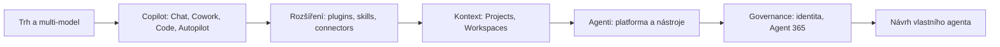

# Agenda — 6 h (běh 2026-11-26)

Skutečný průběh dne. Pro samostudium projděte bloky ve stejném pořadí.

| Čas | Min | Blok | Složka |
|---|---|---|---|
| 09:15–10:15 | 60 | Trh AI asistentů + Code, Cowork, Autopilot | [`ai-market`](ai-market/), [`copilot-news`](copilot-news/) |
| 10:15–11:00 | 45 | Živé demo Code a Cowork, Copilot Credits, monitoring a řízení nákladů, hosting aplikací, správa v admin centru | [`copilot-news`](copilot-news/) |
| 11:00–11:30 | 30 | *Oběd* | |
| 11:30–12:15 | 45 | Plugins v Cowork (skills + connectors) | [`cowork-extensibility`](cowork-extensibility/) |
| 12:15–12:45 | 30 | Konektory a skills v Chatu | [`cowork-extensibility`](cowork-extensibility/) |
| 12:45–13:00 | 15 | *Přestávka* | |
| 13:00–13:30 | 30 | Projects → Copilot Workspaces | [`projects-workspaces`](projects-workspaces/) |
| 13:30–14:15 | 45 | AI agenti: co to je a čím je postavit (MS-4014 M1 + M2) | [`ai-agents-intro`](ai-agents-intro/), [`agent-platform`](agent-platform/) |
| 14:15–14:40 | 25 | Identita a governance agentů | [`agent-governance`](agent-governance/) |
| 14:40–14:55 | 15 | *Přestávka* | |
| 14:55–15:40 | 45 | Workshop „Naplánuj si agenta“ (MS-4014 M3) | [`plan-agent-solution`](plan-agent-solution/) |
| 15:40–15:50 | 10 | Závěr, Q&A | [`review`](review/) |

## Osa dne

