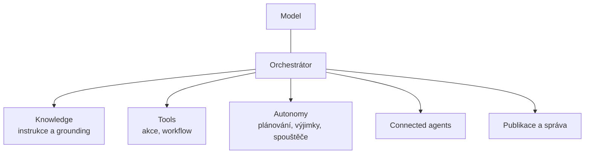

# Blok 5 · Co je AI agent

> Typ: výklad · Odhad: 15 min · Zdroj: MS-4014 Modul 1 — *Introduction to developing AI agents*

## Cíle

- Definujete **AI agenta** a jeho **business hodnotu**.
- Rozlišíte **tři vzory**: retrieval, task, autonomous.
- Popíšete **komponenty** agenta.

## Co je agent

Agent používá AI k **automatizaci a vykonávání business procesů** — vedle člověka nebo za něj, pro jednotlivce, tým nebo celou organizaci.

| Vzor | Co dělá | Příklad z Copilotu |
|---|---|---|
| **Retrieval** | Odpovídá z firemních znalostí | agent z Agent Builderu nad směrnicemi |
| **Task** | Vykonává vícekrokovou práci s hranicemi a lidskou kontrolou | Copilot Cowork |
| **Autonomous** | Běží na spouštěč nebo plán, sleduje, rozhoduje, jedná | Autopilot, automations v Cowork |

> [!TIP] Nevybírejte „nejautonomnějšího“ agenta
> Vybírejte vzor podle rizika, kvality dat a míry dohledu, kterou zvládnete.

## Business hodnota

| Bolest | Přínos agenta |
|---|---|
| Ruční opakovaná práce | Automatizace rutiny, lidé dělají hodnotnější práci |
| Znalosti v silech | Znalost na vyžádání napříč systémy |
| Procesy čekají na předání | Proces pokračuje bez čekání |
| Backlog roste rychleji než tým | Kapacita roste bez navýšení lidí |
| Informace přichází pozdě | Rozhodování v reálném čase |

**Jak začít:** vylepšete **existující proces**. Zmapovat → posoudit proveditelnost a ROI → pilot → zapojit a iterovat → měřit a škálovat.

Příklady z průmyslu: prediktivní údržba, koordinace dodavatelů, dokumentace BOZP, onboarding nových zaměstnanců, provozní reporting.

## Komponenty agenta

Příklad jednoho požadavku: *„Jaká je cestovní politika a zarezervuj mi let do Prahy příští týden.“*

1. **Retrieve** — najde politiku ve firemní dokumentaci.
2. **Act** — zavolá rezervační systém s parametry z konverzace a politiky.
3. **Respond** — shrne výsledek a potvrdí rezervaci.

## Kontrolní otázky

1. Jaký je rozdíl mezi task a autonomous agentem?
2. Do kterého vzoru patří Copilot Cowork a do kterého Autopilot?
3. Které tři komponenty agent kombinuje nad modelem a orchestrátorem?
4. Proč začínat vylepšením existujícího procesu?
