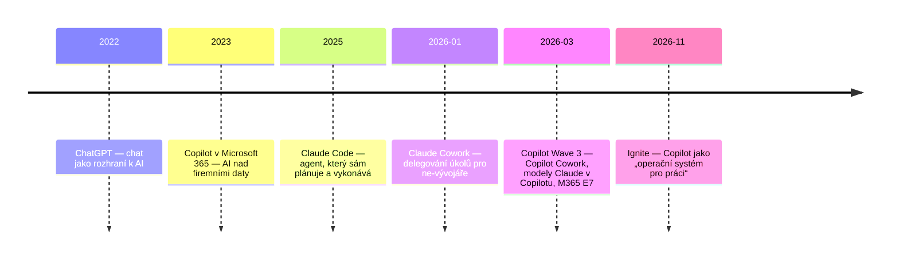

# Blok 1 · Trh AI asistentů a multi-model Copilot

> Typ: výklad · Odhad: 30 min · Zdroj: vlastní (nad rámec MS-4014)

## Cíle

- Rozlišíte **aplikační vrstvu** (kde lidé s AI pracují) a **modelovou vrstvu** (co AI pohání).
- Pochopíte, jak **ChatGPT, Claude a Gemini** změnily očekávání uživatelů od Copilotu.
- Víte, proč Copilot dnes používá **modely více dodavatelů**.

## Dvě vrstvy trhu

| Vrstva | Co měří | Stav 2026 |
|---|---|---|
| **Aplikace ve firmách** | kde lidé AI reálně používají | Microsoft Copilot má nejširší nasazení ve velkých firmách (73 % největších a 82 % menších enterprise firem jej má schválený nebo používá; Gemini 47 %, ChatGPT Enterprise 44 %, Claude 20 % — [Morning Consult, 7/2026](https://morningconsult.com/articles/state-of-enterprise-ai)). |
| **Modely** | čí model generuje odpovědi | Trh se rozdělil mezi OpenAI, Anthropic a Google; Anthropic v dubnu 2026 poprvé předstihl OpenAI v adopci mezi americkými firmami ([VentureBeat](https://venturebeat.com/ai/anthropic-finally-beat-openai-in-business-ai-adoption-but-3-big-threats-could-erase-its-lead)). |
| **Útraty** | kam jdou peníze | Enterprise útraty za AI vzrostly v roce 2026 na 177 mld. USD; tři frontier laby (Anthropic, OpenAI, Google) z nich mají 69 % ([Menlo Ventures](https://menlovc.com/wp-content/uploads/2026/11/menlo_ventures_enterprise_ai_report-2026-110326.pdf)). |

> [!WARNING] Průzkumy měří různé věci
> Licence, adopce a útraty dávají různá pořadí. Sledujte **trend**, ne jedno číslo.

**Shrnutí:** Microsoft vyhrává distribuci — lidé už pracují v Teams, Outlooku a Office. Modelová vrstva je naopak konkurenční a rychle se mění.

## Jak ostatní změnili práci s Copilotem

1. **ChatGPT** naučil lidi „mluvit s AI“. Uživatelé přicházejí se spotřebitelskými návyky a vlastními účty — vzniká **shadow AI**.
2. **Gemini** ukázal sílu distribuce: AI přímo v nástrojích, které už lidé mají (Workspace, Android, vyhledávání).
3. **Claude (Code, Cowork)** posunul očekávání od „ptám se“ k **„deleguji úkol a kontroluji výsledek“**.
4. **Microsoft reagoval v březnu 2026 (Wave 3):** Copilot Cowork postavený s Anthropic, modely Claude dostupné v celém Copilot Chatu, výběr modelu podle úkolu ([Fortune](https://fortune.com/2026/03/09/microsoft-copilot-cowork-ai-agents-anthropic-e7-m365-saas/)).

## Co to znamená pro uživatele

| Dříve | Dnes |
|---|---|
| Ladit „dokonalý prompt“ | Zadat **cíl, kontext a kontrolní body** |
| Jedna odpověď v jednom okně | Úkol běží minuty až hodiny, výsledkem jsou soubory |
| Jeden model | Copilot volí model podle úkolu (OpenAI, Anthropic, Microsoft MAI) |
| AI jako osobní pomocník | AI jako **kolega s identitou a rozpočtem** (Autopilot, Agent 365) |

> [!IMPORTANT] Modely Anthropic a EU Data Boundary
> Podle Microsoftu jsou modely Anthropic v Copilotu, Researcheru a Copilot Studiu **aktuálně mimo EU Data Boundary** ([Microsoft](https://www.microsoft.com/en-us/copilot/resources/compete-copilot-vs-claude-enterprise)). Zda je máte k dispozici, rozhoduje admin vašeho tenantu.

## Kontrolní otázky

1. Proč může mít Microsoft nejširší nasazení AI ve firmách, i když nevyrábí nejpoužívanější model?
2. Jaký posun v práci s AI přinesly nástroje typu Claude Cowork?
3. Co ve vaší firmě rozhoduje o tom, který model Copilot použije?

## Stav produktu / delta

> [!WARNING] Ověřit k datu běhu — stav k 2026-11.
> Podíly na trhu se mění po čtvrtletích. Před dalším během aktualizovat čísla z nových průzkumů.
