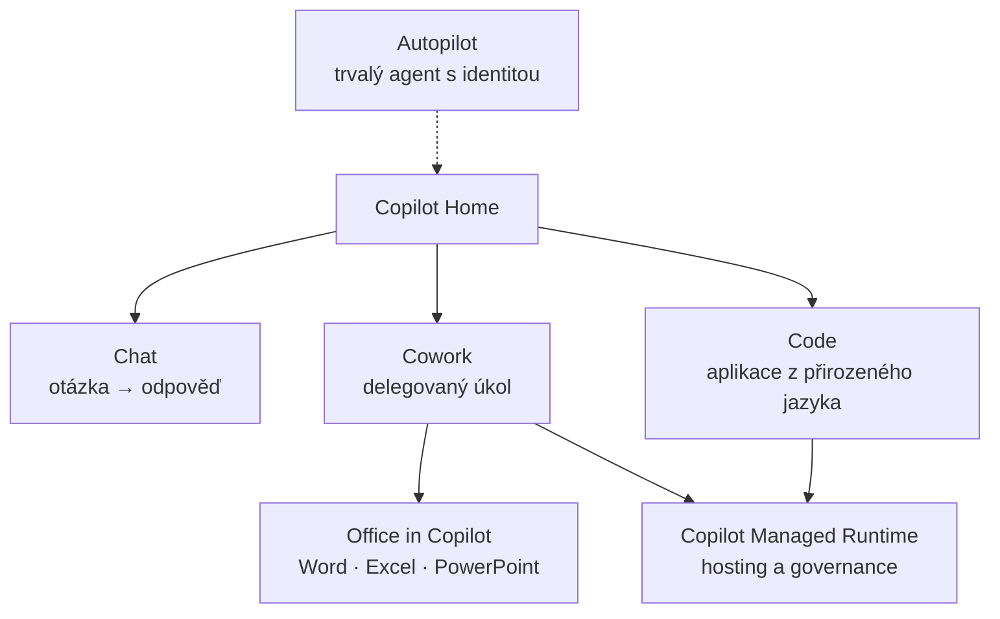

# Blok 2 · Novinky Microsoft Copilotu

> Typ: výklad + dema · Odhad: 75 min · Zdroj: Wave 3 (3/2026), Microsoft Ignite 2026 (17.–20. 11. 2026)

## Cíle

- Znáte **čtyři pilíře nového Copilotu**: Chat, Cowork, Code, Autopilot.
- Rozlišíte, co je **GA** a co jen ve **Frontier** programu.
- Víte, jak funguje **účtování přes Copilot Credits** a kde se řídí náklady.
- Víte, kde se **hostují** aplikace vytvořené v Copilotu a jak je spravuje admin.

## Copilot jako „operační systém pro práci“

Od Ignite 2026 Microsoft prezentuje Copilot jako jeden propojený systém pro lidi a agenty ([DEV/Ignite souhrn](https://dev.to/amananandrai/microsoft-ignite-2026-every-announcement-sorted-models-github-copilot-azure-windows-more-4gk4)).



## Přehled novinek

| Novinka | Co to je | Status k 2026-11-26 |
|---|---|---|
| **Copilot Home** | Chat a Cowork na jednom místě | GA |
| **Copilot Cowork** | Dlouho běžící vícekrokové úkoly napříč Microsoft 365 | GA pro všechny tenanty s Microsoft 365 Copilot ([Learn](https://learn.microsoft.com/en-us/copilot/cowork/whats-new)) |
| **Office in Copilot** | Word, Excel, PowerPoint vedle chatu; v ceně licence | GA |
| **Copilot Code** | Aplikace z přirozeného jazyka | Frontier, GA plánována na prosinec 2026 ([Book of News](https://news.microsoft.com/events/ignite/2026/book-of-news/)) |
| **Autopilot** | Trvalý proaktivní agent s vlastní identitou | Frontier |
| **Copilot Workspaces** | Sdílený prostor týmu a agentů | Frontier — viz [`projects-workspaces`](../projects-workspaces/) |
| **Today** | Ranní brief a prioritizované akce v Outlooku a Copilotu | Private preview; Brief v licenci, Feed čerpá kredity ([EPC Group](https://www.epcgroup.net/insights/microsoft-ignite-2026-day-1-announcements)) |
| **Copilot Managed Runtime** | Hosting a governance aplikací z Code, Cowork, Copilot Studia | GA |
| **Purview Copilot DLP** | Blokuje odkazování na citlivé soubory i bez labelu | Preview |

## Copilot Cowork

Cowork je **delegování práce**, ne konverzace. Zadáte cíl, Cowork navrhne plán, průběžně pracuje (minuty až hodiny) a výsledky ukládá do Microsoft 365.

- Vznikl ve spolupráci s Anthropic; využívá technologii Claude Cowork, ale běží **v cloudu uvnitř Microsoft 365** a dědí jeho bezpečnost a compliance ([VentureBeat](https://venturebeat.com/orchestration/microsoft-announces-copilot-cowork-with-help-from-anthropic-a-cloud-powered)).
- Pracuje nad e-maily, soubory, Teams, kalendářem — přes **Work IQ** (viz [`agent-platform`](../agent-platform/)).
- Rozšiřuje se **pluginy** (skills + connectors) — viz [`cowork-extensibility`](../cowork-extensibility/).
- Umí **automations**: úkoly na plán nebo na událost.

**Jak zadávat úkol Cowork:**

```text
Cíl: Připrav podklady na čtvrtletní poradu oddělení.
Vstupy: soubory ve složce OneDrive „Q4 porada“, poslední vlákno v kanálu Teams „Provoz“.
Výstupy: 1) shrnutí na 1 stranu ve Wordu, 2) 5 slidů v PowerPointu, 3) návrh e-mailu týmu.
Kontrolní bod: e-mail mi před odesláním ukaž ke schválení.
```

> [!TIP] Cowork vs. agent
> **Agent** (např. z Agent Builderu) je znovupoužitelná *role* s instrukcemi a znalostmi. **Cowork** je jednorázové *delegování úkolu*. Opakuje-li se stejný úkol, uložte postup jako **skill**.

## Copilot Code

- Z popisu v přirozeném jazyce vznikne funkční aplikace (formulář, tracker, malý nástroj).
- Aplikace se publikuje do **Copilot Managed Runtime** — Microsoft spravuje hosting, identitu a governance; volitelně datové úložiště ve Fabric.
- Pro IT znamená Code novou kategorii **„citizen-built“ aplikací**, které je potřeba evidovat a řídit stejně jako Power Apps.

## Autopilot

- Trvalý agent, který pracuje proaktivně mezi jednotlivými požadavky.
- Má **vlastní identitu** (Microsoft Entra Agent ID) — je to tedy „autonomní agent“ ve smyslu MS-4014 (viz [`ai-agents-intro`](../ai-agents-intro/)).
- Před zapnutím musí mít agent **vlastníka** — governance viz [`agent-governance`](../agent-governance/).

## Náklady: Copilot Credits

Část funkcí je **v ceně licence Microsoft 365 Copilot**, část se účtuje spotřebou v **Copilot Credits**.

| V licenci | Čerpá kredity (příklady) |
|---|---|
| Copilot Chat, Office in Copilot, Today Brief | spotřební část Cowork, Today Feed, agenti z Copilot Studia, Dynamics 365 agenti |

> [!WARNING] Ověřit k datu běhu
> Hranice „v licenci vs. kredity“ se mění. Ověřte aktuální stav v Microsoft 365 admin center a na stránkách licencí.

**Řízení nákladů** ([Plain Concepts](https://www.plainconcepts.com/microsoft-ignite-2026-recap/)):

- **Agent 365 Cost Management** (preview) — limity, politiky a alerty útrat; po dosažení limitu uživatel ztrácí přístup do dalšího období.
- **Agent 365 Business Analytics** (Frontier) — útraty, adopce a výsledky pro business.
- Limity a alerty kreditů v **Microsoft 365 Cost Management**, Viva Insights dashboard spotřeby.
- Pro pro-code agenty: per-agent pohled ve **Azure Cost Management**, AI gateway v Azure API Management.

## Správa v admin centru

Microsoft 365 admin center → **Copilot**: inventář agentů, schvalování agentů pro organizaci (Copilot Control System), nasazení pluginů, nastavení modelů a nákladů. Detail v [`agent-governance`](../agent-governance/).

## Kontrolní otázky

1. Jaký je rozdíl mezi Copilot Chat a Copilot Cowork?
2. Které z novinek jsou GA a které jen ve Frontier programu?
3. Kde běží aplikace vytvořená v Copilot Code a kdo ji spravuje?
4. Které funkce čerpají Copilot Credits a jak lze útraty omezit?
5. Proč je Autopilot „autonomní agent“?

## Stav produktu / delta

> [!WARNING] Ověřit k datu běhu — stav k 2026-11-26.
> - Copilot Code: GA plánována na prosinec 2026.
> - Autopilot, Workspaces: Frontier — sledovat přechod do GA.
> - Agent 365 Cost Management: preview.
> - Today: private preview.
