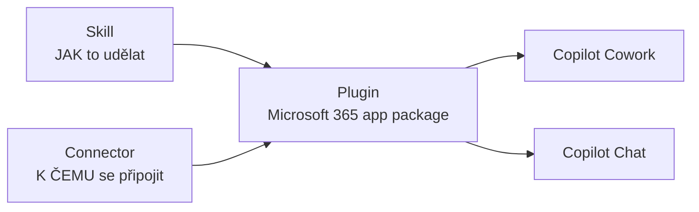

# Blok 3 · Plugins, skills a connectors

> Typ: výklad + demo · Odhad: 75 min (Cowork 45 + Chat 30) · Zdroj: Microsoft Learn — Copilot Cowork

## Cíle

- Víte, z čeho se skládá **plugin**: **skills** a **connectors**.
- Umíte najít, zapnout a vypnout plugin a vytvořit **vlastní skill**.
- Rozlišíte **Copilot connectors**, **Power Platform connectors** a **MCP connectors**.
- Víte, kdy data **opouští tenant**.

## Tři způsoby, jak rozšířit Copilot



| Stavební kámen | Co dělá | Příklad |
|---|---|---|
| **Skill** | Uložené instrukce pro opakovaný úkol (soubor `SKILL.md`): kroky, formát, kontroly. Cowork ho použije, když požadavek odpovídá popisu. | „Týdenní report směny“, „Příprava podkladů na poradu“ |
| **Connector** | Živé napojení na externí systém nebo data, typicky přes **MCP** | Jira, ServiceNow, SAP, Planner |
| **Plugin** | Balíček skills a/nebo connectors distribuovaný přes Microsoft 365 App Store | Sales, Service, Legal, Finance plugin |

## Plugins v Cowork

- Plugin je **Microsoft 365 app package** — stejný formát jako Teams aplikace a Copilot agenti. Obsahuje až **20 skills** a **10 connectorů** ([Build plugins](https://learn.microsoft.com/en-us/copilot/cowork/cowork-plugin-development)).
- **Katalog** (stav 11/2026, [Available plugins](https://learn.microsoft.com/en-us/microsoft-365/copilot/cowork/cowork-available-plugins), [What's new](https://learn.microsoft.com/en-us/copilot/cowork/whats-new)):
  - role-based: Sales, Service, Education, Legal, Finance (sekce *Roles & Industry*),
  - Microsoft: Planner, OneNote, Dynamics 365 (Sales, Customer Service, ERP), Fabric IQ, SharePoint Skills,
  - partneři: např. Jira, Salesforce, ServiceNow, SAP ERP, Workday HCM, Zendesk, Harvey.
- **Nasazení:** admin nasadí plugin celé organizaci; uživatel ho pak najde bez instalace. V panelu **Sources & Skills** si ho může vypnout pro nové konverzace ([Manage plugins](https://learn.microsoft.com/en-us/copilot/cowork/cowork-manage-plugins)).
- **Customize:** jedna stránka pro plugins a skills — procházení, instalace, sdílení, tvorba vlastního skillu řízenou konverzací.
- **Kompatibilita s Claude:** Cowork umí převést balík skills ve formátu Claude na publikovatelný plugin.
- **Automations:** plugin spolu s Power Platform connectory umí spustit práci při události (nový případ, změna stavu obchodu) ([Tech Community](https://techcommunity.microsoft.com/blog/microsoft-copilot-blog/what%E2%80%99s-new-in-cowork-expanded-plugins-and-role-based-skills/4566221)).

### Vzor vlastního skillu

```markdown
---
name: tydenni-report
description: Připraví týdenní report z podkladů v OneDrive složce „Reporty“ a z kanálu Teams „Provoz“.
---

# Postup
1. Najdi soubory upravené za posledních 7 dní ve složce „Reporty“.
2. Shrň klíčová čísla a odchylky od minulého týdne.
3. Z kanálu „Provoz“ vyber rozhodnutí a otevřené problémy.

# Výstup
- Word, max. 1 strana: Čísla · Odchylky · Rozhodnutí · Otevřené body.
- Každé tvrzení s odkazem na zdrojový soubor nebo zprávu.

# Kontroly
- Chybí-li data za některý den, uveď to. Nic nedopočítávej.
```

> [!TIP] Hands-on pro samostudium
> [Copilot Developer Camp — Build your first Cowork plugin](https://microsoft.github.io/copilot-camp/pages/copilot-cowork/02-cowork-plugins/) provede tvorbou pluginu se skills a MCP connectorem.

## Konektory a skills v Copilot Chatu

| Typ | Jak funguje | Data | Kdy použít |
|---|---|---|---|
| **Copilot connectors** (dříve Graph connectors) | Obsah externího systému se **indexuje** do Microsoft Graph, respektuje oprávnění zdroje | zůstávají v tenantu | dokumentace, wiki, on-premises obsah, který má Copilot „znát“ |
| **Power Platform connectors** | Živé volání API přes spravovaný konektor | podle konektoru | akce v business aplikacích |
| **MCP connectors** | Živé volání nástrojů na MCP serveru | odchází na server poskytovatele | externí služby, systémy bez indexace |

- **Skills v Chatu** (listopad 2026): uložené instrukce se rozšiřují z Cowork do Chatu; vlastní, kolegů nebo sdílené organizací ([Windows Forum](https://windowsforum.com/news/microsoft-365-copilot-october-2026-update-workspaces-chat-skills-and-purview-dlp.450293/)).
- **Rozšířená podpora konektorů** (říjen 2026): Cowork používá Power Platform i Copilot connectors ([What's new](https://learn.microsoft.com/en-us/copilot/cowork/whats-new)).

> [!IMPORTANT] Datová suverenita
> Copilot connector **indexuje do vašeho tenantu** — data zůstávají pod vašimi politikami. **MCP connector třetí strany posílá dotazy a data mimo tenant.** O tom, které connectory jsou povolené, rozhoduje admin.

## Kontrolní otázky

1. Jaký je rozdíl mezi skillem a connectorem?
2. Kdo může plugin nasadit celé organizaci a jak ho uživatel vypne?
3. Kdy zvolit Copilot connector a kdy MCP connector?
4. Při kterém typu konektoru data opouštějí tenant?
5. Navrhněte jeden skill pro úkol, který ve své práci opakujete každý týden.

## Stav produktu / delta

> [!WARNING] Ověřit k datu běhu — stav k 2026-11.
> Katalog pluginů roste měsíčně. Skills v Chatu se zaváděly v listopadu 2026.
