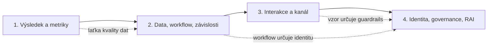

# Blok 8 · Plánování agentního řešení

> Typ: výklad + workshop · Odhad: 45 min · Zdroj: MS-4014 Modul 3 — *Plan an AI agent solution*

## Cíle

- Naplánujete agenta ve **čtyřech oblastech**: výsledek a metriky · data a workflow · interakce a kanál · identita, governance a RAI.
- Odnesete si **jednostránkový návrh** vlastního agenta ([`workshop-template.md`](workshop-template.md)).

## Proč plánovat před stavbou

Agenti nejčastěji selžou na **neměřeném úspěchu**, **neověřených datech**, **chybějících pravidlech** a **podceněném lidském dohledu**. Plánování rozhoduje, jestli agent získá důvěru, nebo ho po prvním vážném incidentu potichu vypnou.

## 1 · Výsledek a metriky

- **Výsledek** je měřitelné „před a po“, ne seznam funkcí. Např. *čas do první odpovědi ze 2 pracovních dnů pod 2 hodiny.*
- **Rozsah**: co agent dělá a **co nedělá**. Začít úzce, prokázat hodnotu, rozšiřovat záměrně.
- **Lidský dohled**: kdy předat člověku, co začíná se schválením, co je zakázané (*boundary map*).
- **Funkční a bezpečnostní požadavky** jsou akceptační kritéria — sepsat je **před** výběrem platformy.
- **Metriky kvality**: míra vyřešení, přesnost, správnost eskalací.
- **Business hodnota** ve 4 pilířích: **efektivita, kvalita, výnosy, strategie**.
- **Baseline před spuštěním**: čas na úkol, chybovost, cena za interakci. Bez baseline nelze dokázat přínos.

## 2 · Data, workflow, závislosti

- Datové domény → služby IQ (viz [`agent-platform`](../agent-platform/)). **Kvalita dat je brána**, ne detail implementace.
- Workflow **vstup → transformace → výstup**. U každého kroku: *potřebuje úsudek AI, nebo stačí pravidlo?*

| Vzor | Kdy |
|---|---|
| **Deterministický** | compliance, přesné znění, nulová tolerance odchylek |
| **Generativní** | znalostně náročné, nejednoznačné vstupy |
| **Hybridní** | většina produkčních agentů — šev mezi AI a pravidly volíte záměrně |

- **Modularita**: vstupní agent + specializovaní agenti s jasnými předávkami.
- **Nástroje**: destruktivní akce (zápis, odeslání) = potvrzení, kontrola úplnosti, logování. Nedestruktivní = záložní cesta, nikdy tiché selhání.

## 3 · Interakce a kanál

- **Konverzační** (uživatel řídí) vs. **autonomní** (spouštěč nebo sledování, člověk v kontrolních bodech).
- Čtyři pravidla: kdy jednat sám · jak eskalovat (předání s kontextem / označení k revizi / notifikace) · co při nízké jistotě · co s citlivým obsahem.
- Kanál podle toho, **kde lidé už pracují** — Copilot, Teams, vlastní aplikace, A2A.

## 4 · Identita, governance, bezpečnost, RAI

Viz [`agent-governance`](../agent-governance/): identitní model, blueprint se sponzorem, guardrails na čtyřech místech, lifecycle.

**Responsible AI** jako návrhové otázky:

| Princip | Otázka |
|---|---|
| Fairness | Může směrování nebo kategorizace znevýhodnit některou skupinu? |
| Reliability & safety | Jak selže a jak to zachytíme? |
| Privacy & security | Jaká osobní data zpracovává a jak je chrání? |
| Inclusiveness | Zvládnou ho všichni uživatelé (jazyk, přístupnost, kanál)? |
| Transparency | Vědí lidé, že mluví s agentem? Lze zpětně vysvětlit jeho kroky? |
| Accountability | Kdo odpovídá za chybný výstup? |

## Kontrolní otázky

1. Tým chce měřit přínos agenta, ale nezná současný stav procesu. Co udělá jako první?
2. Krok převádí kód kategorie na frontu. AI, nebo pravidlo?
3. Agent sám sleduje požadavky, klasifikuje je a navrhuje odpovědi, které schvaluje člověk. Konverzační, nebo autonomní?
4. Proč je agent bez deprovisioning triggeru riziko?
