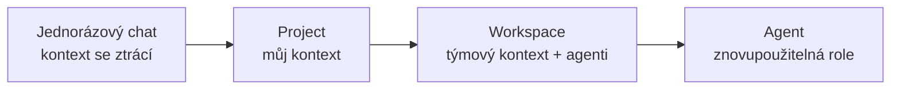

# Blok 4 · Projects a Copilot Workspaces

> Typ: výklad + demo · Odhad: 30 min · Zdroj: Microsoft Ignite 2026, Copilot Cowork changelog

## Cíle

- Rozlišíte **osobní kontext** (Projects) a **týmový kontext** (Workspaces).
- Víte, proč na kontextu záleží víc než na „dokonalém promptu“.
- Chápete, jak Projects a Workspaces vedou k **agentům**.

## Proč kontext

Každá nová konverzace dřív začínala od nuly — znovu vysvětlit cíl, znovu přiložit soubory, znovu napsat pravidla. Projects a Workspaces kontext **uchovávají a sdílejí**.

## Projects

- Drží pohromadě **úkoly, instrukce a kontext** jednoho tématu.
- V Copilot Cowork od října 2026, v Copilot Chatu od listopadu 2026 ([What's new in Cowork](https://learn.microsoft.com/en-us/copilot/cowork/whats-new), [Windows Forum](https://windowsforum.com/news/microsoft-365-copilot-october-2026-update-workspaces-chat-skills-and-purview-dlp.450293/)).
- Příklad: projekt „Příprava rozpočtu 2027“ — instrukce (formát, měna, schvalovatel), soubory, rozpracované úkoly Cowork.

## Copilot Workspaces

- **Sdílený prostor**, kde lidé a agenti pracují na stejném cíli se společným kontextem.
- **Nástupce Copilot Notebooks** — existující notebooky a jejich sdílení se přenesou ([TechRepublic](https://www.techrepublic.com/article/news-microsoft-ignite-2026-announcements/)).
- Objevuje se i v **Teams**.
- Status: **Frontier** (ne GA).

| | Project | Workspace |
|---|---|---|
| Pro koho | jednotlivec | tým |
| Obsah | úkoly, instrukce, soubory | sdílený kontext, lidé, agenti |
| Kde | Cowork, Chat | Copilot, Teams |
| Status 11/2026 | postupný rollout | Frontier |

> [!TIP] Projekt, Workspace, nebo agent?
> **Projekt** = moje práce na jednom tématu. **Workspace** = společná práce týmu. **Agent** = když chcete stejné chování nabídnout dalším lidem opakovaně a s pravidly (role, instrukce, znalosti).

## Kontrolní otázky

1. Jaký problém řeší Projects?
2. Čím se liší Workspace od Projectu?
3. Co se stalo s Copilot Notebooks?
4. Kdy už nestačí Workspace a je lepší postavit agenta?

## Stav produktu / delta

> [!WARNING] Ověřit k datu běhu — stav k 2026-11.
> Workspaces ve Frontier; Projects v Chatu se zaváděly do poloviny listopadu 2026.
